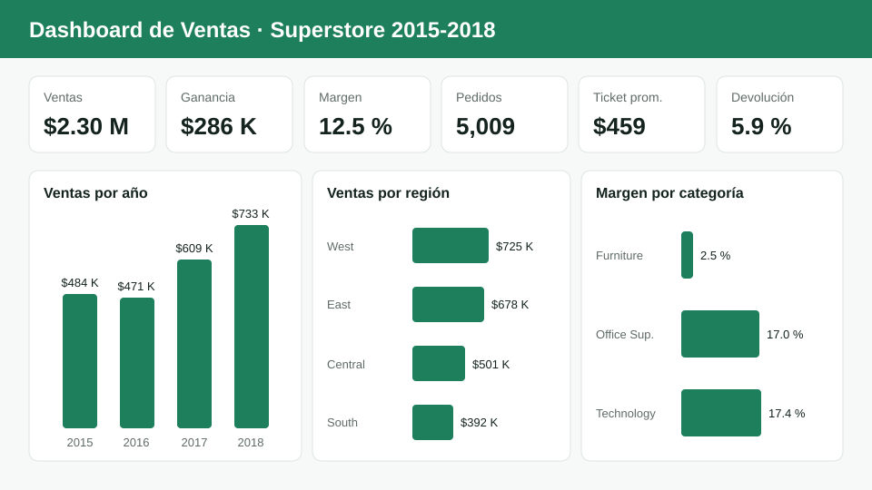

# Dashboard de Ventas y Reporte Automatizado

Proyecto personal | Lima, Perú | Octubre 2026

Flujo completo de análisis de ventas minoristas: **limpieza de datos con Python (pandas)**, **modelo relacional
para Power BI con medidas DAX** y **reporte en Excel generado automáticamente** con tablas resumen y gráficos.




<!-- Cuando armes el dashboard en Power BI, agrega aquí tus capturas:

-->

## Resultados

| | |
|---|---|
| Registros procesados | **9,994** líneas de pedido, en 3 tablas mezcladas dentro de un mismo CSV |
| Limpieza | 1 duplicado eliminado, 11 códigos postales nulos imputados, 438 filas con código postal sin el cero inicial corregidas, fechas en texto convertidas, 32 IDs de producto con nombres en conflicto resueltos con clave sustituta |
| Modelo | Esquema estrella: 1 tabla de hechos y 5 dimensiones |
| Indicadores | 12 medidas DAX y 9 KPIs en el reporte de Excel |
| Automatización | Reporte de 7 hojas y 5 gráficos generado en **~2 segundos** |

**Hallazgos del análisis (2015 a 2018):**
- Ventas por **$2.30 M** con un margen de **12.5 %**. Las ventas crecieron **51 %** entre 2015 y 2018.
- **West** es la región con más ventas ($725 K, margen 14.9 %). **Central** tiene el margen más bajo (7.9 %).
- **Furniture** vende casi lo mismo que Technology, pero con un margen de solo **2.5 %**.
  Las subcategorías **Tables** (−$17.7 K), **Bookcases** y **Supplies** generan pérdidas.

## Arquitectura

```
data/raw/superstore.csv
        │  src/limpieza.py        separa las tablas, corrige formatos, nulos y duplicados
        ▼
data/processed/  (+ registro_limpieza.json con cada cambio)
        │  src/modelo_datos.py    construye el esquema estrella
        ▼
data/model/  fact_ventas · dim_fecha · dim_producto · dim_cliente · dim_geografia · dim_region
        │                                   │
        ▼                                   ▼
src/reporte_excel.py                  Power BI Desktop
reports/*.xlsx                        powerbi/ (medidas DAX + guía)
```

### Modelo de datos (estrella)

```
            dim_fecha        dim_producto
                 \              /
  dim_cliente -- fact_ventas -- dim_geografia -- dim_region
```

## Cómo ejecutarlo

```bash
python -m venv .venv
.venv\Scripts\activate          # Windows  (Linux/Mac: source .venv/bin/activate)
pip install -r requirements.txt

python main.py                  # limpieza + modelo + reporte
python src/reporte_excel.py --anio 2017   # reporte de un solo año
pytest                          # pruebas
```

Salida de ejemplo:

```
1. Limpieza: 9994 filas -> 9993 (1 duplicados eliminados)
2. Modelo:   fact_ventas (9993), dim_fecha (1826), dim_producto (1894), dim_cliente (793), dim_geografia (632), dim_region (4)
3. Reporte:  reporte_ventas_completo_20261027.xlsx en 2.03 s
```

## Reporte en Excel

Ejemplo: [`reports/ejemplo_reporte_ventas.xlsx`](reports/ejemplo_reporte_ventas.xlsx)

| Hoja | Contenido |
|---|---|
| Resumen | 9 KPIs (ventas, ganancia, margen, pedidos, clientes, ticket promedio, unidades, tasa de devolución, días de envío) y ventas por año con gráfico |
| Ventas por mes | Serie mensual con gráfico de líneas |
| Por región | Ventas, margen y responsable por región, con gráfico |
| Por categoría | Categoría y subcategoría con participación y gráfico |
| Top productos | Los 10 productos más vendidos, con gráfico |
| Region x Categoria | Matriz cruzada de ventas y margen (como una tabla dinámica) |
| Datos | Detalle completo como Tabla de Excel con filtros |

## Dashboard en Power BI

- [`powerbi/medidas_dax.md`](powerbi/medidas_dax.md): 12 medidas DAX (ventas, margen, ticket promedio, tasa de devolución, año anterior, crecimiento anual, acumulado YTD, ranking).
- [`powerbi/GUIA_POWERBI.md`](powerbi/GUIA_POWERBI.md): importación, relaciones, páginas y visuales del dashboard.

## Estructura

```
├── main.py                 # ejecuta todo el flujo
├── src/
│   ├── limpieza.py
│   ├── modelo_datos.py
│   └── reporte_excel.py
├── tests/test_pipeline.py
├── data/{raw,processed,model}/
├── powerbi/
├── reports/
└── docs/img/            # vista previa y capturas del dashboard
```

## Dataset

**Sample - Superstore** (Tableau), dataset público de ventas minoristas de EE. UU. con 9,994 líneas de pedido entre 2015 y 2018.
La copia usada se obtuvo de [leonism/sample-superstore](https://github.com/leonism/sample-superstore) e incluye en un solo CSV
las tablas de pedidos, responsables por región y devoluciones.

## Autor

**Giovany Torres Apolinario**: [GitHub](https://github.com/giovanydevv) · [Portafolio](https://giovanydevv.github.io)
